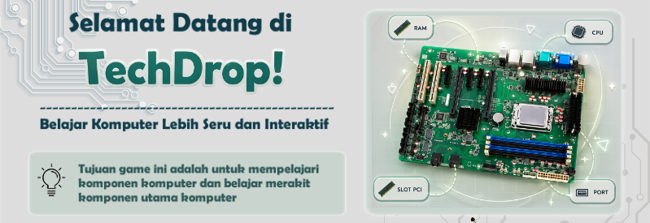
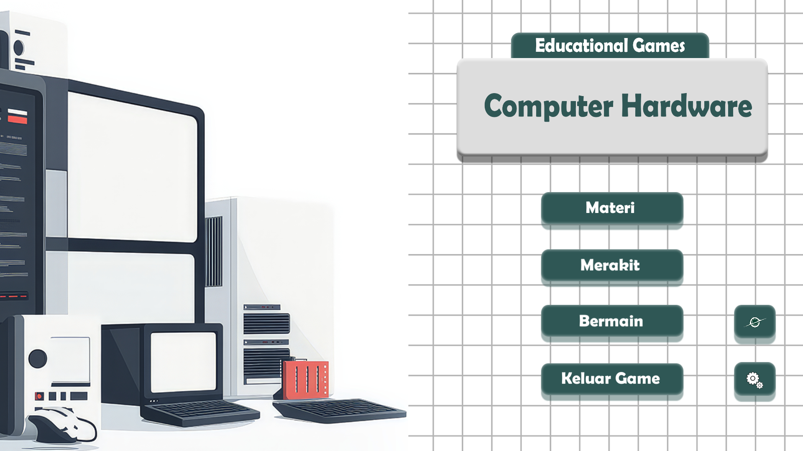
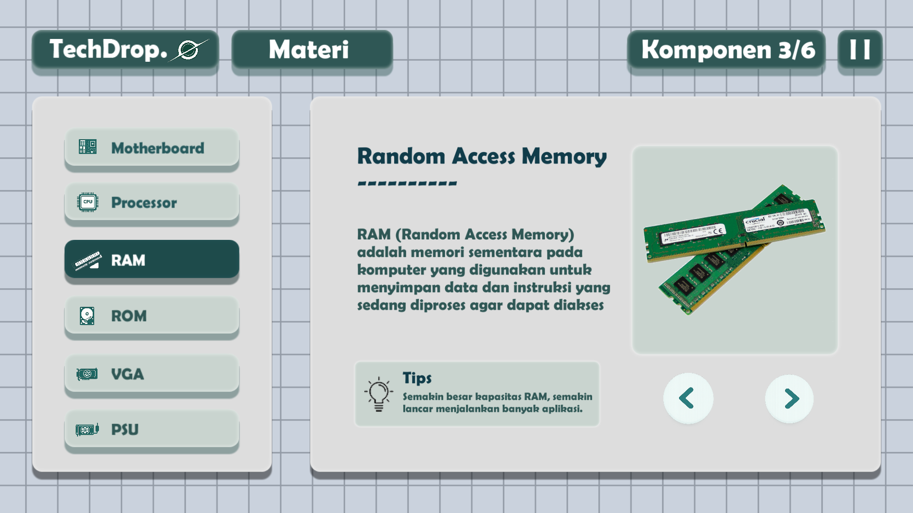
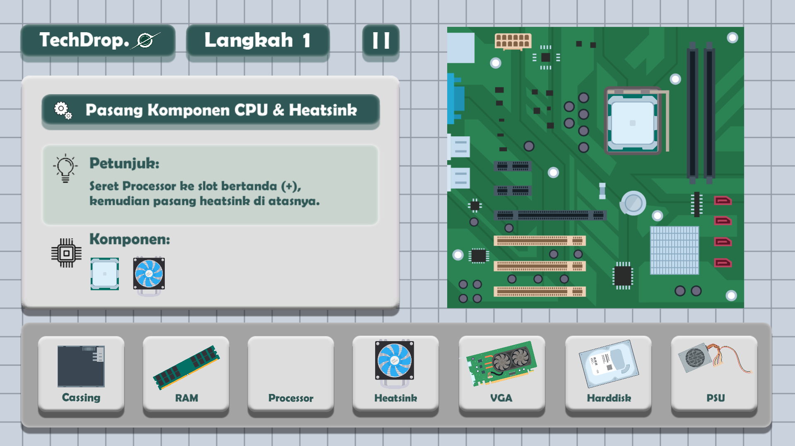
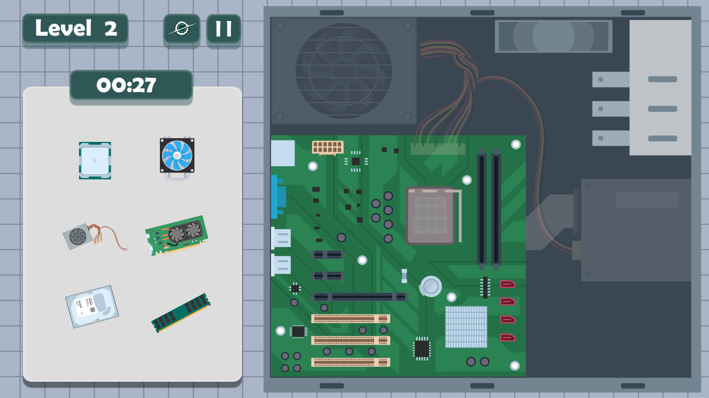
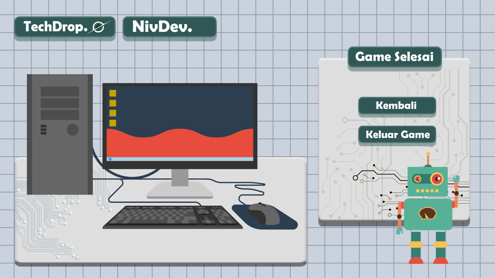

# 📖 MANUAL BOOK & BUKU PANDUAN PENGGUNA
# TECHDROP 2.0 — Game Edukasi Pengenalan & Simulasi Merakit Perangkat Komputer

  

---

## 📑 DAFTAR ISI
1. [Pendahuluan](#1-pendahuluan)
2. [Spesifikasi Sistem](#2-spesifikasi-sistem)
3. [Instalasi dan Cara Menjalankan Game](#3-instalasi-dan-cara-menjalankan-game)
4. [Antarmuka dan Navigasi Menu Utama](#4-antarmuka-dan-navigasi-menu-utama)
5. [Mode Materi: Ensiklopedia Komponen Komputer](#5-mode-materi-ensiklopedia-komponen-komputer)
6. [Mode Merakit: Simulasi Langkah demi Langkah](#6-mode-merakit-simulasi-langkah-demi-langkah)
7. [Mode Bermain: Tantangan Drag & Drop (Level 0 - 26)](#7-mode-bermain-tantangan-drag--drop-level-0---26)
8. [Pengaturan Audio (SFX & BGM)](#8-pengaturan-audio-sfx--bgm)
9. [Kontrol Game](#9-kontrol-game)
10. [Troubleshooting & Solusi Kendala](#10-troubleshooting--solusi-kendala)
11. [Glosarium Istilah Perangkat Keras](#11-glosarium-istilah-perangkat-keras)

---

## 1. PENDAHULUAN

### 1.1 Tentang Game
**TechDrop 2.0** adalah permainan simulasi edukatif 2D yang dirancang khusus untuk mempermudah siapa saja—mulai dari siswa sekolah, mahasiswa, hingga pemula di dunia teknologi informasi—dalam memahami fungsi, bentuk, dan cara perakitan komponen perangkat keras komputer (PC hardware).

Melalui antarmuka visual yang modern dan interaktif, pengguna tidak hanya membaca teori komponen, tetapi juga merasakan pengalaman langsung merakit komputer dalam lingkungan virtual yang aman dan menyenangkan.

### 1.2 Tujuan Pembelajaran
* Mengenalkan komponen inti pemrosesan, penyimpanan, pendinginan, dan grafis pada komputer.
* Melatih pemahaman tentang posisi dan slot tempat setiap komponen dipasangkan pada Motherboard dan Casing PC.
* Mengasah ketangkasan kognitif dan kecepatan identifikasi hardware melalui tantangan berbatas waktu.

---

## 2. SPESIFIKASI SISTEM

Game ini dibangun menggunakan mesin permainan **Unity** yang sangat optimal dan ringan, sehingga dapat dimainkan pada berbagai kelas komputer Windows tanpa memerlukan kartu grafis diskrit (dedicated GPU) kelas tinggi.

| Komponen | Spesifikasi Minimum | Spesifikasi Direkomendasikan |
| :--- | :--- | :--- |
| **Sistem Operasi** | Windows 7 / 8 / 10 / 11 (64-bit) | Windows 10 / 11 (64-bit) |
| **Prosesor (CPU)** | Intel Core i3 / AMD setara (2.0 GHz) | Intel Core i5 / AMD Ryzen 3 ke atas |
| **Memori (RAM)** | 2 GB RAM | 4 GB RAM atau lebih |
| **Grafis (GPU)** | Integrated Graphics (Intel HD 4000 / AMD Vega) | Intel UHD Graphics / NVIDIA GeForce GT series |
| **Ruang Penyimpanan** | 300 MB ruang kosong | 500 MB ruang kosong |
| **Perangkat Masukan** | Mouse & Keyboard | Mouse dengan Scroll Wheel & Keyboard |
| **Audio** | Sound Card kompatibel DirectX | Speaker / Headphone Stereo |

---

## 3. INSTALASI DAN CARA MENJALANKAN GAME

Terdapat dua cara untuk memainkan TechDrop 2.0:

### Metode A: Menggunakan Versi Standalone (Direktori Ini)
1. Pastikan Anda telah mengunduh atau meng-clone seluruh folder proyek ini.
2. Buka folder `TechDrop 2.0`.
3. Klik ganda pada berkas **`TechDrop 2.0.exe`**.
4. Game akan langsung berjalan dalam jendela aplikasi.

### Metode B: Mengunduh Installer Resmi dari itch.io
1. Kunjungi halaman resmi game di [itch.io: TechDrop](https://khonif-zakaria.itch.io/techdropdev).
2. Klik tombol **Download** pada berkas `TechDrop Installer.exe` (~66 MB).
3. Jalankan berkas installer dan ikuti petunjuk wizard instalasi pada layar komputer Anda.
4. Pintasan (shortcut) game akan otomatis dibuat di Desktop atau Start Menu.

---

## 4. ANTARMUKA DAN NAVIGASI MENU UTAMA

  

Pada halaman Menu Utama, terdapat 4 tombol pilihan utama dan 2 tombol utilitas:

1. **Materi**: Membuka ensiklopedia belajar interaktif untuk membaca penjelasan detail mengenai setiap komponen perangkat keras komputer.
2. **Merakit**: Memasuki mode tutorial simulasi perakitan PC langkah demi langkah dengan panduan visual terstruktur.
3. **Bermain**: Memulai tantangan game mencocokkan perangkat keras ke slot yang tepat dengan batasan waktu (terdiri dari 27 level bertahap).
4. **Keluar Game**: Menutup dan mengakhiri aplikasi permainan.
5. **Ikon Planet / Globe (Kanan Bawah)**: Membuka tautan portofolio dan informasi pengembang.
6. **Ikon Roda Gigi / Settings (Kanan Bawah)**: Membuka panel pengaturan volume suara efek (SFX) dan musik latar (BGM).

---

## 5. MODE MATERI: ENSIKLOPEDIA KOMPONEN KOMPUTER

  

Mode Materi menyajikan informasi terperinci mengenai fungsi, karakteristik fisik, dan tips penting seputar komponen komputer:

### 1. Motherboard (Mainboard / Papan Induk)
- **Fungsi**: Papan sirkuit utama yang menghubungkan seluruh komponen komputer agar dapat berkomunikasi satu sama lain.
- **Bagian Penting**: Socket CPU, Slot RAM (DIMM), Slot PCIe (untuk kartu grafis), Port SATA/M.2 (penyimpanan), Chipset, dan Panel Port I/O belakang.

### 2. Processor (CPU - Central Processing Unit)
- **Fungsi**: Otak utama komputer yang bertugas memproses instruksi logika, aritmatika, dan kalkulasi sistem.
- **Tips**: Pemasangan processor harus memperhatikan tanda segitiga/sudut socket agar pin tidak bengkok atau patah.

### 3. RAM (Random Access Memory)
- **Fungsi**: Memori penyimpanan data sementara berkecepatan tinggi yang digunakan oleh processor saat menjalankan aplikasi dan sistem operasi.
- **Tips**: Semakin besar kapasitas RAM, semakin lancar sistem dalam melakukan multitasking tanpa hambatan.

### 4. ROM / Media Penyimpanan (HDD & SSD)
- **Fungsi**: Media penyimpanan data jangka panjang yang menyimpan file sistem operasi, perangkat lunak, dan data pribadi pengguna secara permanen.
- **Jenis**: Hard Disk Drive (HDD berbasis piringan magnetik mekanik) dan Solid State Drive (SSD berbasis chip flash NAND berkecepatan tinggi).

### 5. VGA Card (Kartu Grafis / GPU - Graphics Processing Unit)
- **Fungsi**: Memproses dan merender data grafis untuk ditampilkan ke layar monitor secara optimal.
- **Penting Untuk**: Desain grafis, rendering video 3D, pemodelan visual, dan bermain game resolusi tinggi.

### 6. PSU (Power Supply Unit)
- **Fungsi**: Mengonversi arus listrik AC dari stopkontak dinding menjadi arus DC bertegangan rendah yang stabil untuk menyuplai daya seluruh komponen PC.

### 7. Heatsink Fan & Cooling System
- **Fungsi**: Menyerap panas berlebih yang dihasilkan oleh processor saat bekerja keras dan membuangnya melalui hembusan sirip kipas untuk mencegah panas berlebih (overheating / thermal throttling).

---

## 6. MODE MERAKIT: SIMULASI LANGKAH DEMI LANGKAH

  

Mode ini membimbing pengguna melalui alur perakitan komputer yang benar:

1. **Langkah 1: Pemasangan CPU & Heatsink Fan**
   - Tarik komponen **Processor** dari baki inventaris bawah ke **Socket CPU** di motherboard.
   - Pasangkan **Heatsink Fan** di atas processor untuk menjamin pendinginan optimal.
2. **Langkah 2: Pemasangan Memori RAM**
   - Seret keping **RAM** ke slot memori (RAM Slot) yang terbuka hingga terpasang sempurna.
3. **Langkah 3: Pemasangan Motherboard ke Casing**
   - Pasang motherboard yang telah terisi CPU & RAM ke dalam sasis casing komputer.
4. **Langkah 4: Pemasangan Power Supply (PSU)**
   - Masukkan unit **PSU** ke kompartemen daya di bagian bawah atau atas casing.
5. **Langkah 5: Pemasangan Media Penyimpanan (Harddisk/SSD)**
   - Tempatkan storage drive pada slot drive bay casing.
6. **Langkah 6: Pemasangan Kartu Grafis (VGA)**
   - Tancapkan kartu VGA ke slot PCIe x16 pada motherboard.

---

## 7. MODE BERMAIN: TANTANGAN DRAG & DROP (LEVEL 0 - 26)

  

Mode Bermain menguji ketangkasan dan ingatan Anda mengenai posisi serta fungsi setiap komponen.

### 7.1 Aturan & Mekanisme Permainan
* **Panel Kiri**: Berisi deretan komponen komputer yang harus dipasangkan.
* **Area Kanan**: Berisi motherboard atau casing PC dengan area target drop.
* **Waktu (Countdown Timer)**: Terdapat batas waktu mundur pada setiap level. Anda harus menempatkan seluruh komponen sebelum waktu habis.
* **Target & Validasi**: 
  - Jika komponen diletakkan pada slot yang **benar**, komponen akan mengunci pada posisinya dan memicu suara notifikasi berhasil (`OnDragBenar`).
  - Jika diletakkan pada slot yang **salah**, komponen akan otomatis kembali ke posisi semula di baki kiri.
* **Kondisi Menang**: Seluruh komponen berhasil dipasang ke slot yang tepat sebelum waktu habis.
* **Kondisi Gagal**: Waktu habis sebelum semua target berhasil terpasang.

  

---

## 8. PENGATURAN AUDIO (SFX & BGM)

Pengguna dapat menyesuaikan kenyamanan pendengaran melalui panel pengaturan yang dapat diakses dari menu utama:
* **Slider Volume BGM**: Mengatur intensitas kekerasan lagu latar belakang permainan.
* **Slider Volume SFX**: Mengatur volume efek suara klik tombol, suara seret komponen, suara keberhasilan pasang, dan suara peringatan waktu.

---

## 9. KONTROL GAME

| Aksi | Perangkat Input | Keterangan |
| :--- | :--- | :--- |
| **Pilih / Klik Tombol** | Mouse Klik Kiri (LMB) | Memilih menu, membuka materi, konfirmasi dialog |
| **Ambil Komponen** | Mouse Klik Kiri Tahan (Hold LMB) | Menahan kursor di atas komponen yang ingin dipindahkan |
| **Seret & Lepas (Drag & Drop)** | Gerakkan Mouse + Lepas Klik | Membawa komponen ke slot tujuan dan melepaskannya |
| **Jeda Permainan (Pause)** | Klik Tombol `II` di Layar | Menjeda timer dan membuka menu pause / resume |
| **Navigasi Halaman Materi** | Klik Panah Kiri (`<`) / Kanan (`>`) | Membaca slide komponen berikutnya atau sebelumnya |

---

## 10. TROUBLESHOOTING & SOLUSI KENDALA

### Q1: Game tidak dapat dibuka atau muncul pesan "Windows protected your PC"?
> **Solusi**: Klik tautan **"More info"** pada jendela SmartScreen Windows, lalu klik **"Run anyway"**. Ini terjadi karena aplikasi belum ditandatangani secara digital dengan sertifikat berbayar.

### Q2: Resolusi layar tidak pas atau sebagian tombol terpotong?
> **Solusi**: Game ini telah dilengkapi skrip adaptif `CameraFit` dan `AutoScale`. Pastikan resolusi monitor Anda diatur pada aspect ratio standar 16:9 (contoh: 1920x1080 atau 1366x768). Anda juga dapat menekan kombinasi tombol `Alt + Enter` untuk beralih antara mode Fullscreen dan Windowed.

### Q3: Tidak ada suara musik atau efek saat bermain?
> **Solusi**: Masuk ke menu **Pengaturan** (ikon roda gigi) di menu utama, dan pastikan kedua slider (BGM dan SFX) tidak berada pada posisi paling kiri (0%).

---

## 11. GLOSARIUM ISTILAH PERANGKAT KERAS

* **ATX (Advanced Technology eXtended)**: Standar dimensi ukuran motherboard dan casing komputer desktop.
* **Chipset**: Kumpulan sirkuit terpadu pada motherboard yang mengatur alur transfer data antara prosesor, memori, dan periferal.
* **DIMM (Dual In-line Memory Module)**: Jenis modul soket fisik tempat menancapkan keping memori RAM pada motherboard PC.
* **PCIe (Peripheral Component Interconnect Express)**: Bus ekspansi berkecepatan tinggi untuk memasang kartu tambahan seperti VGA Card, Sound Card, dan Wi-Fi Card.
* **SATA (Serial AT Attachment)**: Antarmuka standar kabel untuk menghubungkan drive HDD atau SSD konvensional ke motherboard.
* **Thermal Paste (Pasta Pendingin)**: Senyawa konduktif termal yang dioleskan di antara permukaan CPU dan Heatsink untuk memaksimalkan transfer pelepasan panas.
